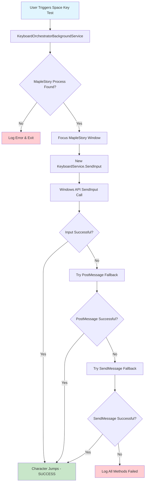
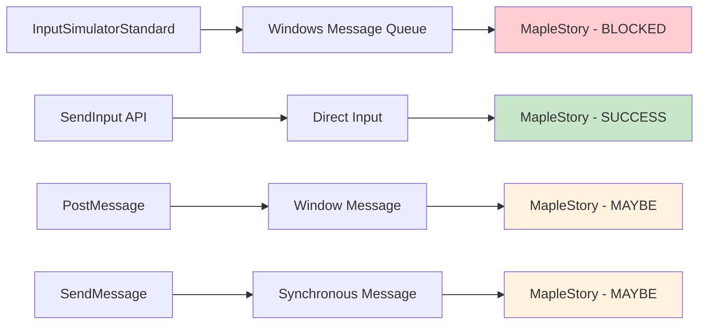
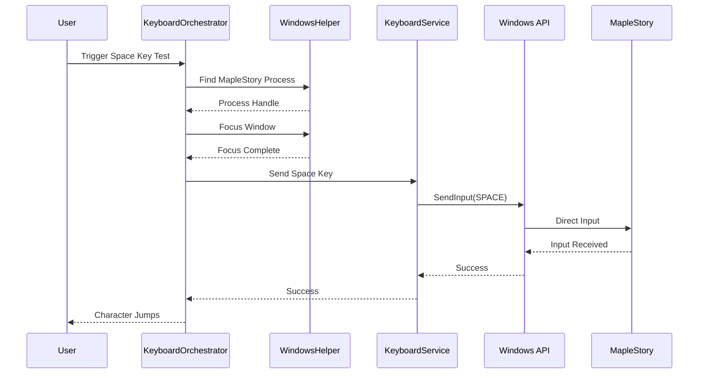

# Implementation Flow Diagram

## Current vs Target Architecture

### Current Flow (Not Working)
```
User Request → KeyboardOrchestratorBackgroundService → KeyboardService → InputSimulatorStandard → Windows Message Queue → MapleStory (BLOCKED)
```

### Target Flow (Working)
```
User Request → KeyboardOrchestratorBackgroundService → New KeyboardService → SendInput API → Direct Input → MapleStory (SUCCESS)
```

## Implementation Flow



## Input Method Comparison



## Process Flow for Space Key Test



